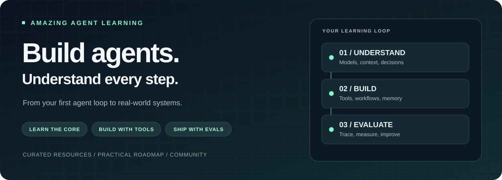
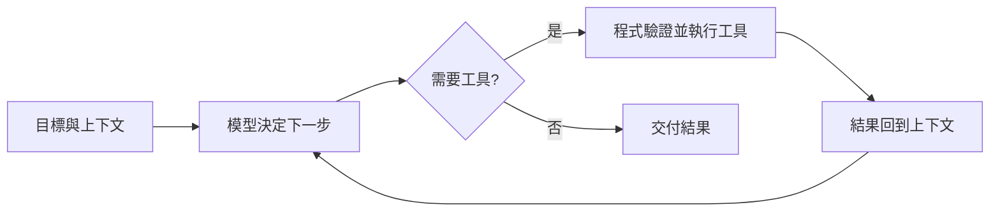

  

<h1 align="center">Amazing Agent Learning</h1>

<strong>從第一個 Agent Loop，到真正能交付的 AI 系統。</strong> 給開發者的 AI Agent 開源學習地圖：172 個 Repo · 6 大主題 · 4 週實作路線

  
  
  
  

  <a href="#start">30 秒選方向</a> · <a href="#picks">10 個起手式</a> · <a href="#roadmap">4 週實作路線</a> · <a href="#catalog">完整資源庫</a> · <a href="#contributing">一起貢獻</a>

---

**想學 AI Agent，卻在 LangGraph、CrewAI、MCP、RAG、Skills 之間迷路？**

這份地圖幫你把「下一個該看哪個 Repo」變成「下一步該做什麼」。從原理、編排、記憶、執行環境到評測與應用，按照學習目的整理，每個階段都有能動手做的練習。

你可以用它選定第一個框架、找到專案缺少的元件，或拆解一個成熟應用的架構。**今天先選一條路，跑通一個範例，再把學到的東西用進自己的專案。**

> **第一次來？** 從 [Microsoft 入門課程](https://github.com/microsoft/ai-agents-for-beginners) 或 [Hugging Face Agents Course](https://github.com/huggingface/agents-course) 選一門，再用 [smolagents](https://github.com/huggingface/smolagents) 理解一次完整的工具執行循環。

## 🧭 30 秒，找到你的起點

- **我剛開始學 Agent** → [課程與核心原理](#foundations)。先看 Agent 如何決定下一步、使用工具與結束任務。
- **我想做自己的 Agent 產品** → [框架與流程編排](#frameworks)。從單一 Agent 做起，再加入狀態、分支與人工介入。
- **我的 Agent 不懂資料，也記不住事情** → [MCP、記憶與 RAG](#context)。分清楚工具接入、知識檢索與長期記憶。
- **我想讓 Agent 操作網頁或執行程式** → [執行環境與基礎設施](#runtime)。找瀏覽器、沙盒與模型服務。
- **我想提升開發效率、量化成果** → [評測與 Coding Agent](#quality)。追蹤工具呼叫、比較結果，再改進流程。
- **我想先做出可以使用的東西** → [Skills 與應用](#applications)。從設計、研究助手、工作流或個人知識庫切入。

## ⭐ 如果今天只挑 10 個，從這裡開始

以下是按學習目的挑選的入口。挑選順序代表建議路線；完整清單還有更多替代方案。

1. **[Microsoft AI Agents for Beginners](https://github.com/microsoft/ai-agents-for-beginners)** — 建立 Agent 全貌。**第一步：** 挑一個 Tool Use 範例，記錄模型輸入、工具參數與回傳結果。
2. **[Hugging Face Agents Course](https://github.com/huggingface/agents-course)** — 按單元理解 Agent、框架與評測。**第一步：** 完成入門單元，寫下 Agent 與固定工作流的差別。
3. **[smolagents](https://github.com/huggingface/smolagents)** — 從精簡的程式碼理解 Code Agent。**第一步：** 跑通範例，再加一個自己的工具。
4. **[LangGraph](https://github.com/langchain-ai/langgraph)** — 學習狀態、持久執行與人工介入。**第一步：** 做出可暫停、檢查狀態、再繼續的工作流。
5. **[CrewAI](https://github.com/crewAIInc/crewAI)** — 理解角色分工的 Crews 與事件驅動的 Flows。**第一步：** 用「研究 → 撰寫」兩個角色，測試交接資料是否足夠。
6. **[Pydantic AI](https://github.com/pydantic/pydantic-ai)** — 將型別與結構化輸出接入 Agent。**第一步：** 為任務結果定義資料結構，檢查缺欄位與錯誤型別如何處理。
7. **[MCP Inspector](https://github.com/modelcontextprotocol/inspector)** — 獨立檢查 MCP Server 的工具與回應。**第一步：** 連接一個範例 Server，列出工具並完成一次呼叫。
8. **[Browser Use](https://github.com/browser-use/browser-use)** — 探索瀏覽器任務的執行流程。**第一步：** 讓 Agent 在測試頁擷取資訊，留下可檢查的結果。
9. **[Langfuse](https://github.com/langfuse/langfuse)** — 追蹤、評估與除錯 LLM 應用。**第一步：** 記錄同一個任務的工具路徑、延遲與成本。
10. **[Dify](https://github.com/langgenius/dify)** — 透過視覺化工作流與 RAG 快速做原型。**第一步：** 建立自己的文件問答流程，用具體問題驗證回答品質。

## 🧠 先看懂一次 Agent Loop

把 Agent 想成一個反覆做決定的程式：接收目標與上下文，決定是否使用工具，讀取執行結果，再決定繼續或交付。

讀程式碼時，優先找這六件事：

- **Loop：** 下一步在哪裡決定？什麼條件會停止？
- **Tools：** 參數如何驗證？工具失敗如何回報？
- **State：** 哪些資料需要跨步驟保存？中斷後如何恢復？
- **Context：** 模型每一步看得到什麼？哪些資料會被移出視窗？
- **Memory：** 哪些資訊值得長期保留？如何更新與取回？
- **Evaluation：** 成功如何定義？修改後如何確認有進步？

**Workflow** 通常由程式預先指定執行路徑；**Agent** 則讓模型決定部分後續步驟。實際產品可以混合兩者。**MCP** 處理工具與上下文的接入方式；**RAG** 把相關資料找回來；**Skills** 封裝可按需載入的任務方法。先理解它們各自處理的問題，再決定要加哪一層。

## 🚀 4 週，把收藏變成作品

這是一條建議練習路線，可依程式基礎調整速度。每週都留下可展示、可檢查的成果。各工具的安裝方式、模型設定與費用，以連結中的上游說明為準。

### Week 1｜跑通最小 Agent

**閱讀：** [Microsoft 入門課程](https://github.com/microsoft/ai-agents-for-beginners)／[Hugging Face 課程](https://github.com/huggingface/agents-course)、[smolagents](https://github.com/huggingface/smolagents)。

- [ ] 跑通一個上游範例，記錄模型與套件版本。
- [ ] 加入一個簡單工具，例如讀取本機測試資料。
- [ ] 觀察一次成功與一次工具失敗的完整過程。
- [ ] 設定停止條件與最大步數。

**本週成果：** 一份能解釋「模型如何選工具、拿到什麼結果、為什麼停止」的執行紀錄。

### Week 2｜讓流程可控制、結果可驗證

**閱讀：** [LangGraph](https://github.com/langchain-ai/langgraph) 或 [CrewAI](https://github.com/crewAIInc/crewAI)，搭配 [Pydantic AI](https://github.com/pydantic/pydantic-ai)。

- [ ] 將任務拆成明確步驟，寫下每一步的輸入與輸出。
- [ ] 為輸出定義 Schema，處理不合格式的結果。
- [ ] 加入一個人工確認節點，檢查後再繼續。
- [ ] 重跑工具超時與資料缺漏的案例。

**本週成果：** 一個可以檢查中間狀態、說明失敗原因的工作流。

### Week 3｜接工具、接資料，再決定是否需要記憶

**閱讀：** [MCP 參考 Servers](https://github.com/modelcontextprotocol/servers)、[Inspector](https://github.com/modelcontextprotocol/inspector)，再從 [LlamaIndex](https://github.com/run-llama/llama_index)、[Haystack](https://github.com/deepset-ai/haystack)、[Mem0](https://github.com/mem0ai/mem0) 選需要的元件。

- [ ] 測試一個 MCP 工具，確認參數與回應格式。
- [ ] 為測試文件建立問答流程，讓答案能對照來源。
- [ ] 準備資料裡找不到答案的問題，觀察如何回應。
- [ ] 若任務需要跨次對話保留資訊，再加入記憶並測試更新。

**本週成果：** 一個使用自己的資料、能展示來源或工具結果的助手。

### Week 4｜評測、展示、交付

**閱讀：** [Langfuse](https://github.com/langfuse/langfuse) 或 [Phoenix](https://github.com/Arize-ai/phoenix)。應用方向可參考 [Dify](https://github.com/langgenius/dify)、[STORM](https://github.com/stanford-oval/storm)、[Browser Use](https://github.com/browser-use/browser-use)。

- [ ] 建立至少 10 個固定案例，包含正常、缺資料與工具失敗情況。
- [ ] 比較成功率、延遲、工具呼叫次數與成本。
- [ ] 修改一個設計選擇，再用同一組案例重跑。
- [ ] 錄製 Demo，寫下啟動方式、使用情境與目前限制。

**本週成果：** 一個有 Demo、評測紀錄與使用說明的 Agent 作品。

> **驗收標準：** 另一位開發者能照你的說明跑起來，並用相同案例重現結果。

## 📚 完整資源庫

以下按學習目的分成六類，合計 **172 個不同 Repo**，另列一個前端設計 Skill 的檔案入口。分類順序從核心到應用；同類工具可選一個深入。每個項目提供直接來源與一句用途，點開分類即可探索。

**導覽：** [① 原理](#foundations) · [② 框架](#frameworks) · [③ 工具與資料](#context) · [④ 執行環境](#runtime) · [⑤ 評測與開發](#quality) · [⑥ Skills 與應用](#applications)

### ① 課程與核心原理

理解模型如何選工具與推進任務，再研究程式化優化及推理方法。

**帶著這個問題讀：** 能否找到工具選擇、執行結果回寫與停止條件？

展開 11 個資源入口

#### 課程與精簡實作

- **[microsoft/ai-agents-for-beginners](https://github.com/microsoft/ai-agents-for-beginners)** — Microsoft 的 Agent 入門課程，從概念與設計模式進入實作。
- **[huggingface/agents-course](https://github.com/huggingface/agents-course)** — Hugging Face 的系統化 Agent 課程，涵蓋框架、實作與評測。
- **[anthropics/courses](https://github.com/anthropics/courses)** · `Archived` — Anthropic 的歷史教學資源，適合參考提示詞與工具使用範例。
- **[rohitg00/ai-engineering-from-scratch](https://github.com/rohitg00/ai-engineering-from-scratch)** — 從零學習 AI 工程的實作資源。
- **[huggingface/smolagents](https://github.com/huggingface/smolagents)** — 以程式碼使用工具的精簡 Agent 函式庫，適合研究核心循環。
- **[stanfordnlp/dspy](https://github.com/stanfordnlp/dspy)** — 把 LLM 應用寫成可組合、可優化的程式模組。
- **[earendil-works/pi](https://github.com/earendil-works/pi)** — 整合 LLM API、Agent Loop、TUI 與 Coding Agent CLI 的工具箱。
- **[yoheinakajima/babyagi](https://github.com/yoheinakajima/babyagi)** — 探索任務驅動 Agent 與函式管理的實驗性專案。
- **[SylphAI-Inc/AdalFlow](https://github.com/SylphAI-Inc/AdalFlow)** — 建構與自動優化 LLM 應用的函式庫。
- **[dair-ai/Prompt-Engineering-Guide](https://github.com/dair-ai/Prompt-Engineering-Guide)** — 提示詞、上下文工程、RAG 與 Agent 相關指南及研究資源。
- **[simplescaling/s1](https://github.com/simplescaling/s1)** — 研究推論時計算擴展；適合延伸理解模型推理，屬模型研究資源。

### ② 框架與流程編排

把單次模型呼叫組成有狀態、可管理的任務流程。

**帶著這個問題讀：** 流程中斷後要保存什麼？何時需要多 Agent？

展開 23 個資源入口

#### 編排、Harness 與研究架構

- **[langchain-ai/langgraph](https://github.com/langchain-ai/langgraph)** — 為長任務提供狀態管理、持久執行與人工介入的編排底座。
- **[microsoft/autogen](https://github.com/microsoft/autogen)** — 用於建構 Agent 系統的程式框架，可研究多 Agent 互動。
- **[crewAIInc/crewAI](https://github.com/crewAIInc/crewAI)** — 以角色分工的 Crews 與事件驅動的 Flows 編排多 Agent。
- **[FoundationAgents/MetaGPT](https://github.com/FoundationAgents/MetaGPT)** — 以軟體團隊協作為切入點的多 Agent 框架。
- **[OpenBMB/ChatDev](https://github.com/OpenBMB/ChatDev)** — 以多 Agent 協作組織開發任務與流程。
- **[pydantic/pydantic-ai](https://github.com/pydantic/pydantic-ai)** — 以 Python 型別、資料驗證與結構化輸出建構 Agent。
- **[agno-agi/agno](https://github.com/agno-agi/agno)** — 建構、執行與管理 Agent 平台的框架。
- **[langchain-ai/deepagents](https://github.com/langchain-ai/deepagents)** — 整合規劃、子 Agent 與檔案系統等能力的 Agent Harness。
- **[camel-ai/camel](https://github.com/camel-ai/camel)** — 探索角色扮演、多 Agent 協作與互動研究。
- **[microsoft/semantic-kernel](https://github.com/microsoft/semantic-kernel)** — 將 LLM 能力接入既有應用的 SDK。
- **[deepset-ai/haystack](https://github.com/deepset-ai/haystack)** — 用模組化管線編排檢索、路由、生成與 Agent 工作流。
- **[run-llama/llama-agents](https://github.com/run-llama/llama-agents)** — 以事件驅動、非同步與步驟式工作流控制 AI 應用。
- **[google/ax](https://github.com/google/ax)** — Google 的 Agent 編排 Runtime。
- **[deepseek-ai/deepseek-harness](https://github.com/deepseek-ai/deepseek-harness)** — 以外掛組織 Agent Harness 的不同元件。
- **[PrimeIntellect-ai/prime-agent](https://github.com/PrimeIntellect-ai/prime-agent)** — 探索遞迴語言模型與長時間編程任務的 Agent。
- **[agiresearch/AIOS](https://github.com/agiresearch/AIOS)** — 以作業系統概念管理 Agent 的研究與實作。
- **[agiresearch/Cerebrum](https://github.com/agiresearch/Cerebrum)** — AIOS 的 Agent SDK，可搭配核心架構研讀。
- **[OpenBMB/XAgent](https://github.com/OpenBMB/XAgent)** — 面向複雜任務求解的自主 Agent 專案。
- **[microsoft/TaskWeaver](https://github.com/microsoft/TaskWeaver)** · `Archived` — 以程式碼規劃與執行資料分析任務的框架。

#### 任務調度與模型生態

- **[PrefectHQ/marvin](https://github.com/PrefectHQ/marvin)** — 將 AI 能力融入 Python 應用的函式庫。
- **[PrefectHQ/prefect](https://github.com/PrefectHQ/prefect)** — Python 工作流與資料管線編排工具，可用於周邊任務調度。
- **[QwenLM/Qwen-Agent](https://github.com/QwenLM/Qwen-Agent)** — Qwen 系列的 Agent 框架，整合工具呼叫、MCP、程式執行與 RAG。
- **[langchain-ai/langchain](https://github.com/langchain-ai/langchain)** — LLM 與 Agent 應用的組件、整合與開發生態。

### ③ MCP、結構化輸出、記憶與 RAG

把工具、資料契約與知識接入 Agent，控制每一步能取得的上下文。

**帶著這個問題讀：** 這個問題需要工具、文件檢索，還是跨次互動的記憶？

展開 27 個資源入口

#### 協定、驗證與工具評測

- **[modelcontextprotocol/modelcontextprotocol](https://github.com/modelcontextprotocol/modelcontextprotocol)** — MCP 規格與文件的官方來源。
- **[modelcontextprotocol/servers](https://github.com/modelcontextprotocol/servers)** — MCP 參考 Servers 與相關實作入口。
- **[modelcontextprotocol/inspector](https://github.com/modelcontextprotocol/inspector)** — 獨立檢查 MCP Server、工具與回應的開發工具。
- **[anthropics/skills](https://github.com/anthropics/skills)** — 以指令、腳本與資源封裝專業任務的 Agent Skills 範例。
- **[BoundaryML/baml](https://github.com/BoundaryML/baml)** — 為 Agent 與結構化 LLM 應用設計的程式語言。
- **[567-labs/instructor](https://github.com/567-labs/instructor)** — 將模型輸出轉成結構化資料的函式庫；原網址為 jxnl/instructor。
- **[microsoft/TypeChat](https://github.com/microsoft/TypeChat)** — 用型別定義建立自然語言介面的函式庫。
- **[ShishirPatil/gorilla](https://github.com/ShishirPatil/gorilla)** — 研究與評估 LLM 函式呼叫能力。
- **[OpenBMB/ToolBench](https://github.com/OpenBMB/ToolBench)** — 工具學習的訓練、服務與評測平台。

#### 長期記憶與知識檢索

- **[letta-ai/letta](https://github.com/letta-ai/letta)** — 提供狀態與進階記憶能力的 Agent 平台。
- **[mem0ai/mem0](https://github.com/mem0ai/mem0)** — 為 Agent 與應用加入跨次互動的記憶層。
- **[topoteretes/cognee](https://github.com/topoteretes/cognee)** — 為 Agent 建立持久記憶的開源平台。
- **[volcengine/OpenViking](https://github.com/volcengine/OpenViking)** — 整合記憶、知識檢索與 Skills 的上下文資料庫。
- **[vectorize-io/hindsight](https://github.com/vectorize-io/hindsight)** — 面向 Agent 的學習型記憶系統。
- **[VectifyAI/PageIndex](https://github.com/VectifyAI/PageIndex)** — 以文件索引與推理進行無向量檢索的 RAG 專案。
- **[VectifyAI/OpenKB](https://github.com/VectifyAI/OpenKB)** — 面向 LLM 的知識庫專案。
- **[microsoft/graphrag](https://github.com/microsoft/graphrag)** — 以圖結構組織資訊的 RAG 系統。

#### 程式碼與上下文管理

- **[DeusData/codebase-memory-mcp](https://github.com/DeusData/codebase-memory-mcp)** — 透過持久化知識圖譜查詢程式碼的 MCP Server。
- **[mksglu/context-mode](https://github.com/mksglu/context-mode)** — 以工具輸出隔離與 Session 記憶管理上下文。
- **[headroomlabs-ai/headroom](https://github.com/headroomlabs-ai/headroom)** — 在進入模型前壓縮工具輸出、日誌、檔案與 RAG 內容。
- **[JuliusBrussee/caveman](https://github.com/JuliusBrussee/caveman)** — 探索精簡語言與 Token 用量的 Skill／Proxy。
- **[aakarim/OpenLore](https://github.com/aakarim/OpenLore)** — 共享與維護 Agent 可檢查的知識與上下文。
- **[Tencent/WeKnora](https://github.com/Tencent/WeKnora)** — 將文件整合成 RAG、推理 Agent 與 Wiki 的知識平台。
- **[andrewyng/context-hub](https://github.com/andrewyng/context-hub)** — 面向 Coding Agent 的 API 文件與上下文資源。

#### 文件處理與檢索基建

- **[infiniflow/ragflow](https://github.com/infiniflow/ragflow)** — 結合文件解析、RAG 與 Agent 的知識引擎。
- **[infiniflow/infinity](https://github.com/infiniflow/infinity)** — 支援向量與全文等混合搜尋的 AI 資料庫。
- **[run-llama/llama_index](https://github.com/run-llama/llama_index)** — 處理文件、索引與資料應用的框架。

### ④ 執行環境與基礎設施

為執行程式、操作網頁與提供模型服務找到合適的 Runtime。

**帶著這個問題讀：** 工具實際在哪裡執行？每一步的權限與成本如何設定？

展開 27 個資源入口

#### 沙盒與工具治理

- **[NVIDIA/OpenShell](https://github.com/NVIDIA/OpenShell)** — 為自主 Agent 提供隔離與存取控制的 Runtime。
- **[e2b-dev/E2B](https://github.com/e2b-dev/E2B)** — 為 Agent 提供隔離的程式執行環境。
- **[e2b-dev/code-interpreter](https://github.com/e2b-dev/code-interpreter)** — 在 AI 應用中執行 Python 或 JavaScript／TypeScript 的 SDK。
- **[e2b-dev/desktop](https://github.com/e2b-dev/desktop)** — 具備圖形桌面的 E2B Sandbox，可用於 Computer Use。
- **[stacklok/brood-box](https://github.com/stacklok/brood-box)** — 在硬體隔離的 MicroVM 中執行 Coding Agent 的 CLI。
- **[amontlabs/silo](https://github.com/amontlabs/silo)** — 提供本機或遠端 Linux 沙盒、桌面與電腦操作環境。
- **[amontlabs/lcu](https://github.com/amontlabs/lcu)** — 將電腦操作能力解耦，供不同 Harness 整合。
- **[stacklok/toolhive](https://github.com/stacklok/toolhive)** — 部署與管理 MCP Servers 的平台。
- **[superagent-ai/superagent](https://github.com/superagent-ai/superagent)** — 面向提示詞注入、資料洩漏與有害輸出的應用防護元件。

#### 瀏覽器、網頁操作與資料擷取

- **[browser-use/browser-use](https://github.com/browser-use/browser-use)** — 讓 Agent 使用瀏覽器完成網頁任務的框架。
- **[browser-use/browser-use-pi](https://github.com/browser-use/browser-use-pi)** — 輕量 TypeScript Web Agent，可用來研究較小的實作。
- **[lightpanda-io/browser](https://github.com/lightpanda-io/browser)** — 面向 AI 與自動化設計的無頭瀏覽器。
- **[lexmount/moli](https://github.com/lexmount/moli)** — 以 Rust 建構、面向 Agent 的無頭瀏覽器。
- **[plasmate-labs/plasmate-mcp](https://github.com/plasmate-labs/plasmate-mcp)** — 將 Plasmate 瀏覽器能力提供給 Agent 的 MCP Server。
- **[alibaba/page-agent](https://github.com/alibaba/page-agent)** — 直接在網頁內透過自然語言操作介面的 JavaScript Agent。
- **[steel-dev/steel-browser](https://github.com/steel-dev/steel-browser)** — 為網頁自動化提供瀏覽器 API 與沙盒環境。
- **[ChromeDevTools/chrome-devtools-mcp](https://github.com/ChromeDevTools/chrome-devtools-mcp)** — 讓 Coding Agent 使用 Chrome DevTools 的 MCP 工具。
- **[firecrawl/firecrawl](https://github.com/firecrawl/firecrawl)** — 擷取網頁資料並提供給 AI 應用的工具。
- **[unclecode/crawl4ai](https://github.com/unclecode/crawl4ai)** — 將網頁擷取與清洗成適合 LLM 使用的內容。
- **[ScrapeGraphAI/Scrapegraph-ai](https://github.com/ScrapeGraphAI/Scrapegraph-ai)** — 以 AI 輔助網頁資料擷取的 Python 工具。

#### 模型服務、路由與決策引擎

- **[BerriAI/litellm](https://github.com/BerriAI/litellm)** — 統一多家模型 API，並提供路由、紀錄與成本管理的 AI Gateway。
- **[vllm-project/vllm](https://github.com/vllm-project/vllm)** — LLM 推論與服務引擎，適合研究部署與吞吐設計。
- **[Niko1221/Strata](https://github.com/Niko1221/Strata)** — 面向消費級硬體的模型推論引擎。
- **[ollama/ollama](https://github.com/ollama/ollama)** — 在本機啟動與使用模型的工具。
- **[xorbitsai/inference](https://github.com/xorbitsai/inference)** — 透過統一 API 部署語言、語音與多模態模型。
- **[jaredpalmer/kev](https://github.com/jaredpalmer/kev)** — 可自行訓練與執行的決策模型系列。
- **[NandhaKishorM/laya](https://github.com/NandhaKishorM/laya)** — 針對選擇、評分與是非判斷的決策引擎。

### ⑤ 評測、可觀測性與 Coding Agent

追蹤 Agent 的行為與結果，並把工具接入日常開發流程。

**帶著這個問題讀：** 修改之後，是否能用同一組案例證明結果改善？

展開 27 個資源入口

#### 評測與觀測

- **[SWE-bench/SWE-bench](https://github.com/SWE-bench/SWE-bench)** — 以真實 GitHub Issue 評測軟體工程任務的基準。
- **[THUDM/AgentBench](https://github.com/THUDM/AgentBench)** — 在多種環境評估 LLM Agent 能力的研究基準。
- **[xlang-ai/OSWorld](https://github.com/xlang-ai/OSWorld)** — 評估 Agent 在真實電腦環境完成操作任務的基準。
- **[evalplus/evalplus](https://github.com/evalplus/evalplus)** — 評估 LLM 生成程式碼的工具與資料。
- **[langfuse/langfuse](https://github.com/langfuse/langfuse)** — 追蹤、評估與除錯 LLM／Agent 應用的平台。
- **[Arize-ai/phoenix](https://github.com/Arize-ai/phoenix)** — AI 應用的可觀測性與評測平台。
- **[AgentOps-AI/agentops](https://github.com/AgentOps-AI/agentops)** — 記錄 Agent 執行、模型成本與相關指標的 SDK。
- **[alibaba/open-code-review](https://github.com/alibaba/open-code-review)** — 結合規則管線與 LLM Agent 的程式碼審查工具。
- **[ifixai-ai/iFixAi](https://github.com/ifixai-ai/iFixAi)** — 檢查 Agent 行為是否符合任務目的的審計工具。

#### 開發方法與 Coding Agent

- **[github/spec-kit](https://github.com/github/spec-kit)** — 支援規格驅動開發的工具包。
- **[obra/superpowers](https://github.com/obra/superpowers)** — 以 Skills 封裝軟體開發方法與工作流程。
- **[OpenHands/OpenHands](https://github.com/OpenHands/OpenHands)** — 面向軟體開發任務的開源 Agent 平台。
- **[SWE-agent/SWE-agent](https://github.com/SWE-agent/SWE-agent)** — 嘗試自動解決 GitHub Issue 的軟體工程 Agent。
- **[aaif-goose/goose](https://github.com/aaif-goose/goose)** — 可擴充、能編輯與執行任務的開源 Agent。
- **[cline/cline](https://github.com/cline/cline)** — 以 SDK、IDE 外掛或 CLI 使用的 Coding Agent。
- **[continuedev/continue](https://github.com/continuedev/continue)** — 可整合開發流程的開源 Coding Agent。
- **[kodu-ai/claude-coder](https://github.com/kodu-ai/claude-coder)** — 在 VS Code 內協助逐步開發的 Agent 外掛。
- **[PawanOsman/OpenCursor](https://github.com/PawanOsman/OpenCursor)** — 支援多模型與 MCP 的 VS Code 編程助手。
- **[Aider-AI/aider](https://github.com/Aider-AI/aider)** — 終端機中的 AI 結對編程工具，整合程式碼地圖與 Git。

#### 多 Agent 工作區與桌面管理

- **[stablyai/orca](https://github.com/stablyai/orca)** — 管理多個並行 Coding Agent 的開發環境。
- **[mvschwarz/openrig](https://github.com/mvschwarz/openrig)** — 組織不同 Coding Agent 的團隊、角色、共享上下文與任務。
- **[pacifio/atlas](https://github.com/pacifio/atlas)** — 追蹤多個 Agent 的程式碼變更與查詢的版本管理工具。
- **[escoffier-labs/brigade](https://github.com/escoffier-labs/brigade)** — 以本機檔案追蹤任務、驗證結果、保存記憶與同步工具。
- **[tigerless-labs/autoharness](https://github.com/tigerless-labs/autoharness)** — 從實際編程 Session 提煉與更新 Skills 的工具。
- **[yetone/magpie](https://github.com/yetone/magpie)** — 從系統列集中切換不同 Agent 使用的模型。
- **[farion1231/cc-switch](https://github.com/farion1231/cc-switch)** — 集中管理多款 Agent 設定的跨平台桌面工具。
- **[Gaurav-Gosain/tuios](https://github.com/Gaurav-Gosain/tuios)** — 管理終端視窗、工作區與 Agent 通知的工具。

### ⑥ Skills 與應用

從可重用的任務方法與完整應用出發，觀察元件如何組合成產品。

**帶著這個問題讀：** 這個應用有哪些可拆解、可重用的工作流程？

展開 58 個資源入口

#### 設計與影音 Skills

- **[Nutlope/hallmark](https://github.com/Nutlope/hallmark)** — 供 Coding Agent 使用的網頁設計 Skill。
- **[Leonxlnx/taste-skill](https://github.com/Leonxlnx/taste-skill)** — 以美術方向、參考影像與瀏覽器檢查引導設計的 Skills。
- **[pbakaus/impeccable](https://github.com/pbakaus/impeccable)** — 為 AI Harness 提供設計語言與指導。
- **[anthropics/skills — frontend-design](https://github.com/anthropics/skills/blob/main/skills/frontend-design/SKILL.md)** — Anthropic Skills 裡的 frontend-design 檔案入口。
- **[nextlevelbuilder/ui-ux-pro-max-skill](https://github.com/nextlevelbuilder/ui-ux-pro-max-skill)** — 跨平台 UI／UX 設計知識與指導 Skill。
- **[haidrrrry/claude-remotion-skill](https://github.com/haidrrrry/claude-remotion-skill)** — 教導 Agent 以 Remotion 建構與編輯動態影片的 Skill。

#### 技能庫、工具整合與領域工作流

- **[ComposioHQ/composio](https://github.com/ComposioHQ/composio)** — 提供工具接入、搜尋、認證與工作環境的 Agent 整合平台。
- **[ComposioHQ/awesome-claude-skills](https://github.com/ComposioHQ/awesome-claude-skills)** — Claude Skills、工具與資源的分類清單。
- **[alirezarezvani/claude-skills](https://github.com/alirezarezvani/claude-skills)** — 涵蓋工程、行銷、產品與業務工作的 Skills 集合。
- **[wshobson/agents](https://github.com/wshobson/agents)** — 面向多種 Agent 工具的外掛與工作流集合。
- **[VoltAgent/awesome-agent-skills](https://github.com/VoltAgent/awesome-agent-skills)** — 官方與社群 Agent Skills 的彙整清單。
- **[sickn33/agentic-awesome-skills](https://github.com/sickn33/agentic-awesome-skills)** — 結合 Skills 目錄、選擇與規劃的本機工具平台。
- **[mattpocock/skills](https://github.com/mattpocock/skills)** — 工程任務導向的 Skills 集合。
- **[DietrichGebert/ponytail](https://github.com/DietrichGebert/ponytail)** — 鼓勵重用既有程式與簡化實作的 Skill。
- **[Panniantong/Agent-Reach](https://github.com/Panniantong/Agent-Reach)** — 讓 Agent 讀取與搜尋多種網路及社群資訊的 CLI。
- **[parallel-web/parallel-agent-skills](https://github.com/parallel-web/parallel-agent-skills)** — Parallel 的 Agent Skills 集合；原網址為 parallel-web/agent-skills。
- **[aws/agent-toolkit-for-aws](https://github.com/aws/agent-toolkit-for-aws)** — AWS 官方提供的 MCP Servers、Skills 與外掛。
- **[cloudflare/security-audit-skill](https://github.com/cloudflare/security-audit-skill)** — 以多階段流程產出與驗證安全審查結果的 Skill。
- **[zhaoxuya520/reverse-skill](https://github.com/zhaoxuya520/reverse-skill)** — 面向逆向工程、授權測試與安全研究的技能路由包。
- **[morluto/rea](https://github.com/morluto/rea)** — 以 Agent 分析應用行為與原生二進位檔的逆向工具。
- **[AgriciDaniel/claude-seo](https://github.com/AgriciDaniel/claude-seo)** — 涵蓋技術 SEO、結構化資料與搜尋最佳化的 Skill。

#### 應用平台、團隊與個人助手

- **[langgenius/dify](https://github.com/langgenius/dify)** — 以視覺化工作流、Agent 與 RAG 建構 AI 應用的平台。
- **[CopilotKit/CopilotKit](https://github.com/CopilotKit/CopilotKit)** — 將 Agent 與生成式 UI 接入前端應用的工具組。
- **[CopilotKit/OpenDots](https://github.com/CopilotKit/OpenDots)** — 整合文字、通話與 Slack 互動的 AI 協作應用。
- **[e2b-dev/fragments](https://github.com/e2b-dev/fragments)** — 使用 E2B 建構 AI 生成應用的 Next.js 模板。
- **[paperclipai/paperclip](https://github.com/paperclipai/paperclip)** — 管理工作中的 Agent 與任務的開源應用。
- **[spinabot/brigade](https://github.com/spinabot/brigade)** — 面向個人與企業情境的智慧助理平台。
- **[msitarzewski/agency-agents](https://github.com/msitarzewski/agency-agents)** — 不同職能與工作流程的 Agent 角色集合。
- **[markfulton/ai-employees](https://github.com/markfulton/ai-employees)** — 以排程角色與例行工作組織 AI 業務助手。
- **[NousResearch/hermes-agent](https://github.com/NousResearch/hermes-agent)** — 面向持續互動與學習的個人 Agent。
- **[openclaw/openclaw](https://github.com/openclaw/openclaw)** — 跨平台的個人 AI 助理與任務執行系統。
- **[openinterpreter/openinterpreter](https://github.com/openinterpreter/openinterpreter)** — 讓模型在電腦上執行程式與任務；原網址為 OpenInterpreter/open-interpreter。
- **[openinterpreter/01](https://github.com/openinterpreter/01)** — 面向桌面、行動裝置與硬體的開源語音介面。
- **[xlang-ai/OpenAgents](https://github.com/xlang-ai/OpenAgents)** — 研究語言 Agent 與多種工具場景的開放平台。

#### 研究、知識與情報

- **[stanford-oval/storm](https://github.com/stanford-oval/storm)** — 透過檢索與多視角提問產出附來源長文的研究系統。
- **[assafelovic/gpt-researcher](https://github.com/assafelovic/gpt-researcher)** — 使用不同模型與資料來源進行深度研究的 Agent。
- **[InternLM/MindSearch](https://github.com/InternLM/MindSearch)** — 以多 Agent 組織網頁搜尋與資訊整理。
- **[khoj-ai/khoj](https://github.com/khoj-ai/khoj)** — 可自託管的個人知識助手與自訂 Agent 平台。
- **[Mintplex-Labs/anything-llm](https://github.com/Mintplex-Labs/anything-llm)** — 以本機優先方式組織文件、模型與 Agent 的應用。
- **[TencentCloud/Octop](https://github.com/TencentCloud/Octop)** — 可自託管、支援多使用者與多 Agent 的 AI 助理。
- **[odysseus-dev/odysseus](https://github.com/odysseus-dev/odysseus)** — 可自託管的 AI 工作區。
- **[KKKKhazix/AIHOT](https://github.com/KKKKhazix/AIHOT)** — 按自訂信源與篩選條件整理熱點與日報的網站框架。
- **[666ghj/MiroFish](https://github.com/666ghj/MiroFish)** — 以多 Agent 互動探索群體模擬的引擎。

#### 影音、CAD、測試與其他垂直應用

- **[debpalash/VoiceStudio](https://github.com/debpalash/VoiceStudio)** — 在本機處理語音克隆、配音、轉錄與有聲內容的工具。
- **[calesthio/OpenMontage](https://github.com/calesthio/OpenMontage)** — 以 Agent、工具與工作流程組織影片製作。
- **[heygen-com/hyperframes](https://github.com/heygen-com/hyperframes)** — 將 HTML 渲染為影片，適合程式化影音製作。
- **[hypit-ai/hypit](https://github.com/hypit-ai/hypit)** — 以 Agent 工作流程製作與變換影片內容。
- **[earthtojake/text-to-cad](https://github.com/earthtojake/text-to-cad)** — 讓 Agent 使用 CAD 建模能力的工具。
- **[rehan-remade/universal-modder](https://github.com/rehan-remade/universal-modder)** — 結合 Agent、Skills 與生成工具的遊戲 Mod 工作流。
- **[Mafifrizi/ARES](https://github.com/Mafifrizi/ARES)** — 組織授權紅隊任務、範圍、模組與報告的平台。
- **[tester-army/e2e](https://github.com/tester-army/e2e)** — 面向網頁與行動應用的端到端測試框架。
- **[stepci/stepci](https://github.com/stepci/stepci)** — 自動化 API 測試與品質驗證工具。
- **[t8y2/dbx](https://github.com/t8y2/dbx)** — 具備 AI 與 MCP 介面的跨平台資料庫客戶端。
- **[aipoch/open-science](https://github.com/aipoch/open-science)** — 結合 Skills、MCP 與 Python／R 執行的科研工作台。
- **[ruvnet/RuView](https://github.com/ruvnet/RuView)** — 從 Wi-Fi 訊號探索空間感知的硬體相關專案。

#### 延伸資源清單

- **[ashishpatel26/500-AI-Agents-Projects](https://github.com/ashishpatel26/500-AI-Agents-Projects)** — 按產業整理 Agent 使用案例與實作資源。
- **[caramaschiHG/awesome-ai-agents-2026](https://github.com/caramaschiHG/awesome-ai-agents-2026)** — Agent、框架與周邊工具的分類資源清單。
- **[ARUNAGIRINATHAN-K/awesome-ai-agents-2026](https://github.com/ARUNAGIRINATHAN-K/awesome-ai-agents-2026)** — AI Agent 生態的延伸資源清單。

## 🎯 怎麼選，才不會每個框架都只學一點？

1. **先寫一個具體任務。** 例如「讀取三份測試文件，回答問題並附上來源」，讓需求能被驗收。
2. **從一個 Agent、一組工具開始。** 先跑通完整流程，再根據實際瓶頸加入記憶、編排或多 Agent。
3. **拿同一組案例比較。** 一起看結果品質、執行時間、成本與失敗時的可追蹤性。
4. **讀上游的範例與維護狀態。** 確認文件版本、最近變更及部署條件，選擇自己能持續維護的組合。
5. **留下一個作品。** 把啟動方式、Demo 與評測記錄寫下來，下次可以直接在它上面改進。

## 💬 常見問題

**完全沒做過 Agent，從哪裡開始？**

從 [Microsoft 入門課程](https://github.com/microsoft/ai-agents-for-beginners) 或 [Hugging Face 課程](https://github.com/huggingface/agents-course) 選一門。若還不熟悉 Python、API 與 JSON，先補齊這些基礎，再進入 Week 1。

**一定要用多 Agent 嗎？**

先確認是否存在需要隔離的角色、不同工具權限或獨立子任務。每增加一個 Agent，也會增加交接、上下文與除錯成本；用案例驗證它帶來的改善。

**這個 Repo 可以直接執行嗎？**

這裡提供資源導航與實作路線。可執行範例、安裝指令與依賴在各上游 Repo；四週路線中的勾選項目是建議練習。

**收錄代表每個專案都已實測嗎？**

目前完成 Repo 網址、正式名稱與封存狀態核對，並核對精選入口的上游說明。完整清單的用途摘要用於導航，尚未逐一部署或驗證所有功能；歡迎提交附版本與步驟的實測紀錄。

## 🤝 把你的踩坑經驗，變成下一個人的捷徑

歡迎補充值得學習的專案、修正搬家連結、回報已封存資源，或分享可重現的實作心得。

**新增資源時，請附上：**

- 正式 Repo 網址與建議分類。
- 一句話用途，以及適合學習的概念或使用情境。
- 上游 README／文件中支持描述的來源。
- 若包含實測：套件與模型版本、操作步驟、結果與限制。

以清楚、可查證的描述為主，避免沒有測試條件的速度倍數、成本降幅與「保證效果」。一般工作流、研究基準與 Agent 周邊元件也可收錄，請說明它們與 Agent 的關係。

**[推薦資源或回報問題](https://github.com/kevin801221/amazing-agent-learning/issues/new)** · **[提交 Pull Request](https://github.com/kevin801221/amazing-agent-learning/pulls)**

## 📝 來源與維護

- **最近整理：** 2026-10-15。
- **來源：** 各項目連結指向專案維護者的 Repo；精選介紹以對應的上游 README 與文件為依據。
- **狀態：** 標註 `Archived` 的專案在本次核對時已封存，可作為歷史實作參考。
- **授權：** 各專案的程式碼、文件與素材依其各自的授權條款使用。
- **整理者：** [Kevin / kevin801221](https://github.com/kevin801221)。

感謝所有開源作者、課程製作者與貢獻者。這份地圖的學習入口，來自你們公開分享的知識與實作。

---

<strong>今天選一個 Repo，跑通一個範例，留下自己的第一個 Agent 作品。</strong> 如果這份地圖幫你找到方向，歡迎給一顆 ⭐，或分享給正在學 Agent 的朋友。

<a href="#start">回到起點 ↑</a>

